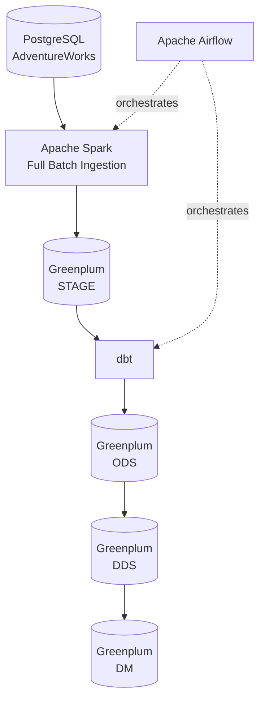
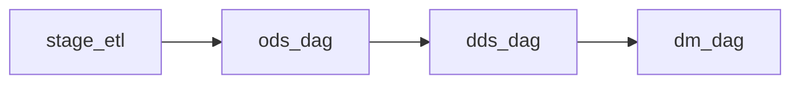
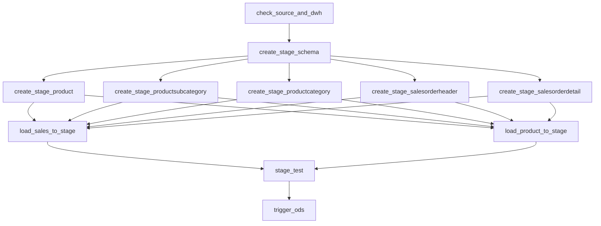
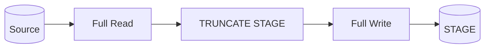
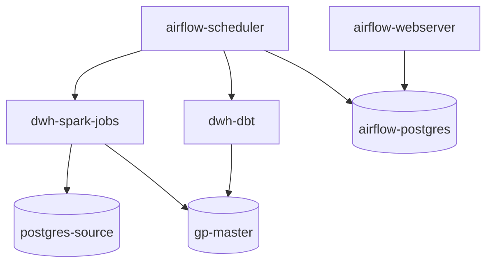

# 🏗️ DWH Lab: ETL/ELT-пайплайн на Spark, Greenplum, dbt и Airflow


> **Для HR и рекрутеров:**  
> Практический Data Engineering-проект, в котором реализован полный путь данных от транзакционного PostgreSQL-источника до аналитического DWH в Greenplum.  
> Используются Apache Spark для batch-загрузки, dbt для построения слоёв ODS/DDS/DM, Apache Airflow для оркестрации и Docker для изоляции инфраструктуры.

---

## 🎯 Ключевые возможности

- **⚡ Full Batch загрузка** — перенос данных из PostgreSQL в Greenplum через Apache Spark и JDBC.
- **🏗️ Многослойный DWH** — архитектура `STAGE → ODS → DDS → DM`.
- **🔄 Оркестрация через Airflow** — независимые DAG для каждого слоя хранилища.
- **🧩 dbt-модели и macros** — построение ODS/DDS/DM и создание STAGE-объектов.
- **✅ Data Quality** — проверки существования таблиц, `NULL`, дублей и количества строк.
- **📦 Docker-инфраструктура** — отдельные контейнеры для Spark, Greenplum, PostgreSQL, dbt и Airflow.
- **🚀 Параллельная загрузка** — независимые Spark jobs для sales и product domain.
- **📊 Аналитические модели** — факт продаж, измерения продукта и даты, витрина месячных продаж.

---

## 🏗 Архитектура и поток данных

Проект построен как классический batch DWH pipeline.



Основной поток:

```text
PostgreSQL
    ↓
Apache Spark
    ↓
Greenplum STAGE
    ↓
dbt ODS
    ↓
dbt DDS
    ↓
dbt DM
```

За управление последовательностью отвечает Apache Airflow.

---

## 🔄 Оркестрация Airflow

Пайплайн разбит на несколько DAG, каждый отвечает за свой слой DWH.



### `stage_etl`



После успешной проверки STAGE автоматически запускается `ods_dag`.

---

## 🧱 Слои хранилища

### 🟡 STAGE

Слой приземления данных.

Spark переносит данные из PostgreSQL в физические таблицы Greenplum:

```text
production.product
        ↓
stage.product

production.productsubcategory
        ↓
stage.productsubcategory

production.productcategory
        ↓
stage.productcategory

sales.salesorderheader
        ↓
stage.salesorderheader

sales.salesorderdetail
        ↓
stage.salesorderdetail
```

STAGE создаётся через dbt macros:

```bash
dbt run-operation create_stage_product
```

Каждая загрузка получает технические поля:

```text
_load_dttm
_batch_id
_source_system
```

---

### 🔵 ODS

ODS содержит очищенные и дедуплицированные данные.

Для выбора актуальной версии записи используется оконная функция:

```sql
ROW_NUMBER() OVER (
    PARTITION BY business_key
    ORDER BY modifieddate DESC, _load_dttm DESC
)
```

В ODS остаётся последняя версия каждой записи.

---

### 🟣 DDS

DDS содержит аналитические факты и измерения.

Основные модели:

```text
fact_sales
dim_product
dim_date
```

Гранулярность `fact_sales`:

```text
1 строка = 1 позиция заказа
```

---

### 🟢 DM

DM содержит готовые аналитические витрины.

Пример реализованной витрины:

```text
monthly_category_sales
```

Она агрегирует продажи по месяцам и категориям товаров.

---

## ⚡ Spark ingestion

Для загрузки используются два независимых Spark job:

```text
full_sales_to_stage.py
full_product_to_stage.py
```

### Sales pipeline

```text
sales.salesorderheader
sales.salesorderdetail
        ↓
Apache Spark
        ↓
stage.salesorderheader
stage.salesorderdetail
```

### Product pipeline

```text
production.product
production.productsubcategory
production.productcategory
        ↓
Apache Spark
        ↓
stage.product
stage.productsubcategory
stage.productcategory
```

---

## 📦 Full Batch загрузка

Текущая стратегия — полная пакетная загрузка.

```text
1. Spark читает всю таблицу source
2. STAGE очищается через TRUNCATE
3. Spark записывает полный набор данных заново
```



Incremental-загрузка по `modifieddate` планируется как следующий этап развития проекта.

---

## 🚀 Параллелизм Spark

Количество JDBC partitions настраивается через переменные окружения:

```env
READ_PARTITIONS=1
WRITE_PARTITIONS=6
```

Во время тестирования было замечено, что основным bottleneck являлась запись в Greenplum.

Пример результатов:

| READ_PARTITIONS | WRITE_PARTITIONS | Total time |
|---:|---:|---:|
| 1 | 1 | ~706 сек |
| 1 | 2 | ~379 сек |
| 1 | 4 | ~244 сек |
| 1 | 6 | ~177 сек |

Текущая конфигурация:

```text
READ_PARTITIONS=1
WRITE_PARTITIONS=6
```

---

## ✅ Data Quality

Перед запуском ODS выполняется отдельная проверка STAGE.

Проверяется:

```text
таблица существует
COUNT(*) > 0
нет NULL в ключевом поле
нет дублей по ключу
source count = stage count
```

Пример:

```text
production.product
source rows = 504

stage.product
stage rows = 504

RESULT = OK
```

Если хотя бы одна проверка падает:

```text
stage_test = FAILED
```

и ODS DAG не запускается.

---

## 🛠 Технический стек

| Область | Технологии | Ключевая роль |
| :--- | :--- | :--- |
| **Source** |  | OLTP-источник AdventureWorks |
| **Ingestion** |  | Full Batch загрузка через JDBC |
| **DWH** |  | Аналитическое хранилище |
| **Transformation** |  | ODS / DDS / DM модели и тесты |
| **Orchestration** |  | DAG, зависимости и запуск контейнеров |
| **Containers** |  | Изоляция сервисов |
| **Languages** |   | Spark jobs, Airflow и DWH |

---

## 📁 Структура проекта

```text
dwh-lab/
│
├── airflow/
│   ├── dags/
│   │   ├── stage_etl.py
│   │   ├── ods_dag.py
│   │   ├── dds_dag.py
│   │   ├── dm_dag.py
│   │   │
│   │   └── common/
│   │       └── docker_config.py
│   │
│   ├── logs/
│   ├── plugins/
│   └── Dockerfile
│
├── dbt/
│   ├── macros/
│   │   └── stage/
│   │
│   ├── models/
│   │   ├── ods/
│   │   ├── dds/
│   │   └── dm/
│   │
│   ├── tests/
│   ├── dbt_project.yml
│   └── profiles.yml
│
├── spark/
│   ├── jobs/
│   │   ├── full_sales_to_stage.py
│   │   └── full_product_to_stage.py
│   │
│   └── Dockerfile
│
├── docker-compose.yml
├── docker-compose.airflow.yml
├── .env.example
├── .gitignore
└── README.md
```

---

## 🐳 Docker-архитектура

В проекте используются отдельные контейнеры для разных компонентов.



Все сервисы объединены общей Docker-сетью:

```text
dwh-net
```

---

## 🔐 Переменные окружения

Секреты не хранятся в Git.

Используется `.env`:

```env
SOURCE_HOST=postgres-source
SOURCE_PORT=5432
SOURCE_DB=adventureworks
SRC_USER=postgres
SRC_PASSWORD=your_password

GP_HOST=gp-master
GP_PORT=5432
GP_DB=dwh
GP_USER=gpadmin
GP_PASSWORD=your_password

READ_PARTITIONS=1
WRITE_PARTITIONS=6

AIRFLOW__CORE__FERNET_KEY=your_fernet_key
```

В репозиторий добавляется только:

```text
.env.example
```

---

## 🚀 Быстрый старт

Убедитесь, что установлен Docker Desktop.

```bash
# 1. Клонирование репозитория
git clone <repository-url>
cd dwh-lab

# 2. Создание .env
cp .env.example .env

# 3. Запуск основной инфраструктуры
docker compose up -d

# 4. Сборка Spark image
docker build -t dwh-spark-jobs:1.0 ./spark

# 5. Запуск Airflow
docker compose -f docker-compose.airflow.yml up -d
```

Airflow UI:

```text
http://localhost:8080
```

---

## 🔌 Airflow Connections

Для `PostgresHook` используются два Airflow Connection:

```text
source_postgres
gp_dwh
```

### Source PostgreSQL

```text
Host: postgres-source
Port: 5432
Database: adventureworks
```

### Greenplum

```text
Host: gp-master
Port: 5432
Database: dwh
```

Пароли Connections шифруются через Airflow Fernet key.

---

## ▶️ Запуск pipeline

В Airflow необходимо запустить только:

```text
stage_etl
```

Дальше остальные DAG запускаются автоматически:

```text
stage_etl
    ↓
ods_dag
    ↓
dds_dag
    ↓
dm_dag
```

---

## 📊 Демонстрация работы

### 🧩 Airflow DAG

<p align="center">
  
</p>

### 🗄️ Слои Greenplum

<p align="center">
  
</p>

### 🔗 dbt lineage

<p align="center">
  
</p>

---

## 🧠 Ключевые архитектурные решения

### Spark отвечает только за ingestion

```text
Spark → перенос данных
dbt → преобразования
Airflow → orchestration
Greenplum → хранение
```

Spark не строит бизнес-слои DWH.

---

### STAGE — физический landing layer

STAGE не является обычной dbt-моделью.

```text
Source
  ↓
Spark
  ↓
STAGE
```

dbt начинает преобразования уже после загрузки STAGE.

---

### Отдельные DAG для каждого слоя

Вместо одного большого DAG:

```text
stage_etl
ods_dag
dds_dag
dm_dag
```

Это позволяет независимо перезапускать отдельные уровни хранилища и упрощает мониторинг.

---

### Отдельные Spark jobs по доменам

```text
Sales
    → full_sales_to_stage.py

Product
    → full_product_to_stage.py
```

Обе загрузки могут выполняться параллельно.

---

## 📈 Что реализовано

- PostgreSQL source на AdventureWorks
- Greenplum DWH
- STAGE / ODS / DDS / DM
- Spark JDBC ingestion
- Full Batch загрузка
- Параллельная запись в Greenplum
- dbt models
- dbt macros
- dbt tests
- Data Quality проверки
- Apache Airflow orchestration
- DockerOperator
- PythonOperator
- PostgresHook
- TriggerDagRunOperator
- Docker Compose
- Environment variables
- Airflow Connections
- Fernet encryption

---

## 🗺 Roadmap

Планируется добавить:

```text
Incremental load по modifieddate
Watermark table
Metadata table для batch-загрузок
Retry / SLA / alerts
CI/CD
Liquibase или Flyway для migrations
S3 как дополнительный источник
Incremental dbt models
Мониторинг Greenplum resource groups
Дополнительные DQ-проверки
```

---

## 👨‍💻 Автор

<p>Антон</p>
<p>Data Engineer</p>
<p>📍 Санкт-Петербург</p>

<p>
Проект разработан как практический Data Engineering стенд для описания построения DWH, с использованием batch загрузки,построения слоев ХД с применением dbt и оркестрацией через Apache Airflow.
</p>
